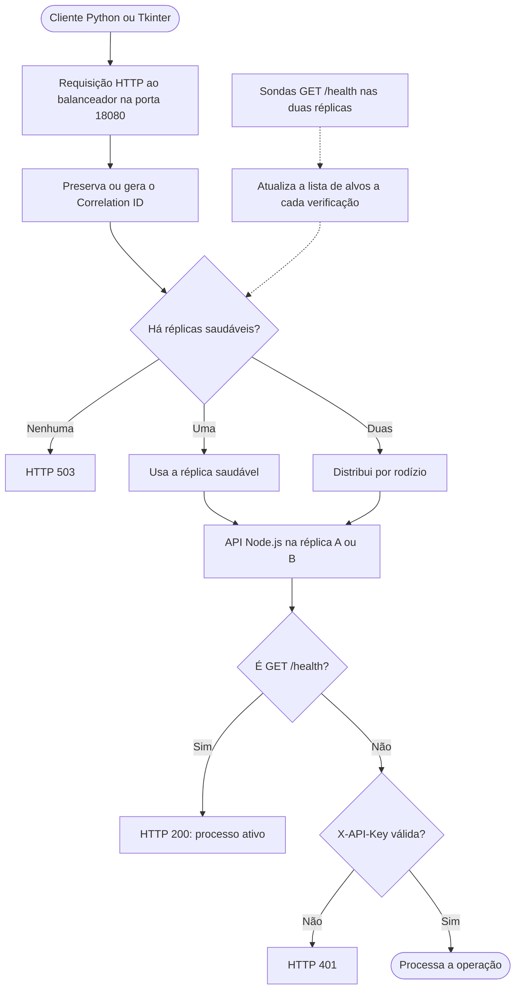
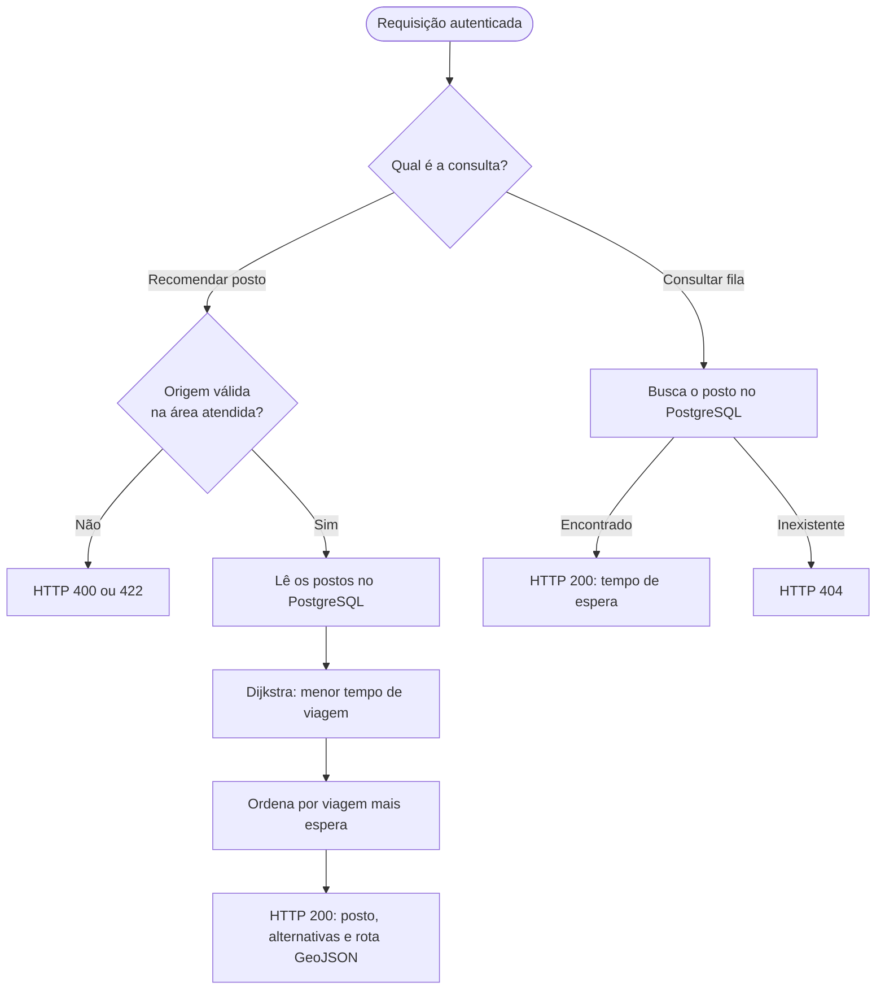
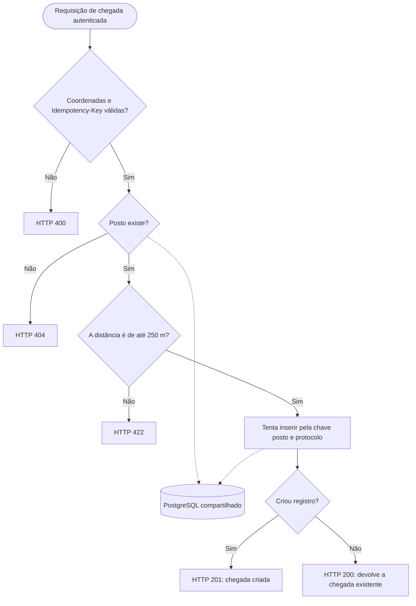
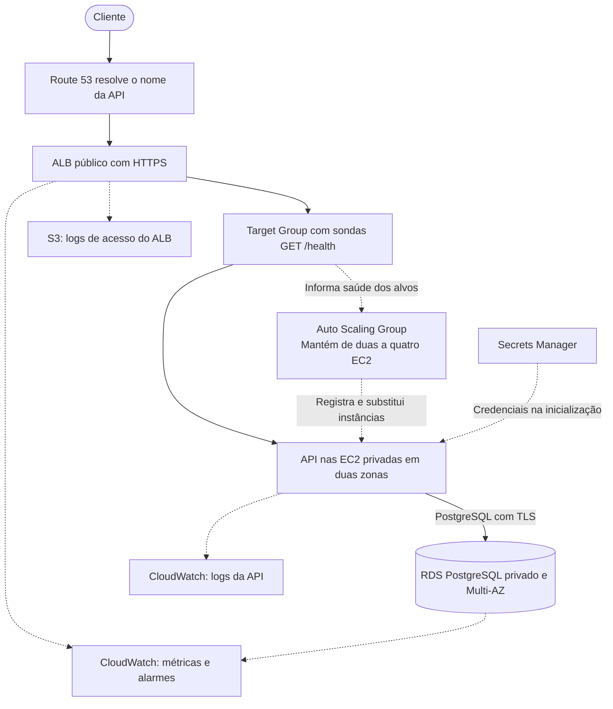

# SAC Bahia · Sistemas Distribuídos

TDE Partes 1 e 2 · Centro Universitário Nobre (UNIFAN) · Sistemas Distribuídos (2026.2)
Prof. Rafael Levi Batista Costa · Equipe 6 · OpenAPI/Swagger SAC

## Equipe e responsabilidades

- **Luiz Henrique Santos de Jesus:** interface Tkinter, infraestrutura, DNS e DevOps.
- **Diego Araujo Silva:** API Node.js, estrutura de dados e segurança.
- **Thiago Gomes de Oliveira:** arquitetura distribuída e tolerância a falhas.

A API Node.js preserva a consulta de fila da Parte 1. Na Parte 2, o cliente Python informa a origem, a API recomenda um posto e devolve uma rota em GeoJSON. O protótipo também registra chegadas com uma chave de idempotência. Os dois processos da API usam a mesma base PostgreSQL.

## Executar a bancada

Requisitos: Docker Desktop ou Docker Engine com Compose v2, Node.js 22 e Python 3. O cliente gráfico também usa Tkinter. Na primeira execução, o Docker baixa as imagens. Use `SAC_PORT` se a porta local 18080 estiver ocupada.

```sh
node scripts/iniciar-local.mjs
docker compose ps
python cliente_python/client.py fila feira
python cliente_python/client.py recomendar -12.979 -38.452
python cliente_python/client.py recomendar -12.257 -38.958
python cliente_python/client.py chegada salvador -12.9769 -38.4553 exemplo-chegada-01
python cliente_python/client_gui.py
```

No Windows, use `py -3` se o comando `python` não estiver disponível. O script preserva as chaves que já existirem em `.secrets/`. O cliente lê a chave por arquivo e usa `http://127.0.0.1:18080` por padrão. Use `SAC_API_URL` se mudar a porta ou o ambiente. `API_KEY_FILE` e `API_KEY` permitem usar outra chave. A porta é publicada apenas no loopback. O balanceador alcança as duas réplicas por DNS do Docker e o banco só aparece na rede interna.

`docker compose down` encerra a bancada e preserva o volume do PostgreSQL. Para desenvolvimento da API com dados em memória, use `npm ci` em `Servidor_node/` e inicie `node server.js` com uma chave de teste em `API_KEY`. Esse modo serve para exercitar as rotas em um único processo. O armazenamento compartilhado e a idempotência entre réplicas são avaliados no Compose.

## Fluxograma da bancada

### Entrada e tolerância a falhas



Durante a detecção de uma queda, uma requisição encaminhada ao alvo indisponível pode receber HTTP 503. Depois que o balanceador retira esse alvo da rotação, o cliente continua usando o mesmo endereço. A réplica volta ao rodízio quando passa na sonda.

### Consulta de fila e recomendação de posto



### Registro de chegada



A rota autenticada `GET /ready` testa o acesso ao catálogo e retorna HTTP 200 se estiver acessível. A API também retorna HTTP 404 para uma rota desconhecida, HTTP 413 para um corpo JSON acima do limite e HTTP 503 se o banco estiver indisponível. O balanceador e a API registram o mesmo `Correlation ID` nos logs das requisições de negócio.

## Contrato e cálculo de rota

O [OpenAPI](openapi.yaml) documenta os caminhos, entradas e respostas. Envie `X-API-Key` em todas as rotas autenticadas.

| Método e caminho | Resultado |
| --- | --- |
| `GET /health` | Verificação de processo aberta ao balanceador. |
| `GET /ready` | Confirma acesso ao catálogo de postos, com autenticação. |
| `GET /postos/{id_posto}/fila` | Espera estimada, com o formato da Parte 1. |
| `POST /recomendacoes` | Posto recomendado, alternativas e rota GeoJSON. Envie latitude e longitude numéricas. |
| `POST /postos/{id_posto}/chegadas` | Registra uma chegada demonstrativa em até 250 m do posto. Envie coordenadas e `Idempotency-Key`. |

A malha simplificada contém conexões no corredor Salvador–Feira de Santana e velocidades de referência. O algoritmo de Dijkstra calcula o menor tempo de viagem no grafo. O ranking soma viagem e espera, permitindo que um posto um pouco mais distante seja recomendado quando sua fila for menor. A resposta identifica `estimativa_grafo_demonstrativo`. Os identificadores legados, as coordenadas aproximadas e as filas simuladas são dados de bancada, com os [postos do SAC Bahia](https://www.sac.ba.gov.br/unidades) como referência. Uma integração institucional usaria dados autorizados de trânsito, disponibilidade de serviço e fila. O check-in valida proximidade das coordenadas informadas. Uma confirmação oficial de presença também exigiria identidade e validação contra manipulação da origem.

O PostgreSQL usa a chave primária composta de posto e protocolo. A primeira chegada retorna HTTP 201. Uma repetição retorna HTTP 200 com o registro já gravado, ainda que seja atendida pela outra réplica. A API não armazena as coordenadas do cidadão e os logs omitem o corpo da requisição e a chave.

## Apresentação e testes de caos

```sh
node scripts/bancada.mjs --compose
docker compose logs --no-color --no-log-prefix balanceador api-a api-b
```

O script usa registros de teste com protocolos exclusivos e verifica os três desafios do barema:

1. **Rajada de 75 requisições.** As duas réplicas recebem recomendações. Uma segunda rajada repete o mesmo check-in e exige um único registro no PostgreSQL.
2. **Falha parcial.** O script para abruptamente a réplica B, registra as respostas durante a detecção, verifica 75 respostas da réplica remanescente e reinicia a réplica B ao final.
3. **Rastreamento.** Uma consulta a posto inexistente retorna HTTP 404. O script procura o mesmo `Correlation ID` no balanceador e na API.

O JSON registra p50 e p95 das requisições bem-sucedidas e a taxa de falha, que inclui respostas 5xx e tentativas sem resposta. Use `--saida=output/bancada-local.json` para atualizar as evidências. Para arguição, demonstre a recomendação e explique por que ela muda com a origem, mostre a detecção pelo balanceador e explique como o banco conserva uma única chegada. O [relatório da Parte 2](output/pdf/Relatorio_TDE_Parte_2.pdf) apresenta o diagnóstico e o cenário regional.

## AWS com Terraform e GitOps

A configuração em [infra/aws](infra/aws) descreve o equivalente na AWS. O ALB HTTPS recebe tráfego via Route 53 e só as EC2 das sub-redes privadas alcançam o RDS. O Target Group verifica `/health`; o Auto Scaling Group registra os alvos, mantém no mínimo duas EC2 e escala de acordo com requisições por alvo. O RDS é privado e Multi-AZ por padrão. A aplicação lê um segredo específico durante a inicialização e conecta ao banco com TLS e usuário de privilégios limitados.



### Pré-requisitos do ambiente AWS

- Conta AWS e região com duas zonas, AMI x86_64 do Amazon Linux 2023, zona pública Route 53 e certificado ACM válido para o host.
- Bucket S3 já existente, versionado e privado para o estado. Use chave de estado distinta por ambiente. O backend usa criptografia e bloqueio S3.
- Repositório ECR privado com tags imutáveis e segredo de aplicação no Secrets Manager com as propriedades `api_key` e `password`. Gere valores novos fora do Git. A chave fixa da Parte 1 deve ser revogada se foi usada fora do protótipo.
- Credenciais temporárias de implantação via perfil AWS ou papel GitHub OIDC autorizado. Use revisão de ambiente para implantações. Restrinja o CIDR de entrada ao ambiente de apresentação. A checagem HTTP do workflow exige um runner dentro desse CIDR.

```sh
terraform -chdir=infra/aws fmt -check
terraform -chdir=infra/aws init -backend=false
terraform -chdir=infra/aws validate
```

Na primeira implantação, configure as variáveis de [versions.tf](infra/aws/versions.tf), publique a imagem no ECR e selecione sua tag. Inicialize o backend com `terraform init -backend-config="bucket=BUCKET" -backend-config="key=sac/terraform.tfstate" -backend-config="region=REGIAO"` em `infra/aws`. Revise o plano antes de aplicar. A infraestrutura inclui recursos tarifados, como ALB, RDS e NAT gateways.

Inicialize o banco uma vez antes do teste funcional. Obtenha `rds_host` e `rds_admin_secret_arn` das saídas Terraform e use uma EC2 gerenciada pelo Systems Manager para encaminhar uma porta local até o RDS com `AWS-StartPortForwardingSessionToRemoteHost`. Conecte com `psql` como `sac_admin` via `host` igual ao endpoint, `hostaddr=127.0.0.1`, porta do túnel, banco `sac` e `sslmode=verify-full` com a CA do RDS. Aplique `infra/db/01-schema.sql` e `infra/db/02-permissoes.sql` e use `\password sac_app` para definir a senha do segredo de aplicação. Valide `/ready` pelo ALB com a chave configurada. Alterações de segredo exigem atualizar o usuário do banco quando aplicável e reiniciar as réplicas de forma progressiva.

No GitHub, configure as variáveis de repositório `TF_AWS_ROLE_ARN`, `TF_BUCKET`, `AWS_REGION`, `SAC_HOSTNAME`, `SAC_ZONE_ID`, `SAC_CERTIFICATE_ARN`, `SAC_INGRESS_CIDR`, `SAC_AMI_ID`, `SAC_ECR_REPOSITORY_URL` e `SAC_APP_SECRET_ARN`. A CI executa a bancada e valida o Terraform. O workflow AWS planeja a partir do Git, publica a imagem identificada pelo hash do código e aplica sob acionamento explícito. A execução agendada sinaliza diferenças no plano. Revise divergências antes da reconciliação.
